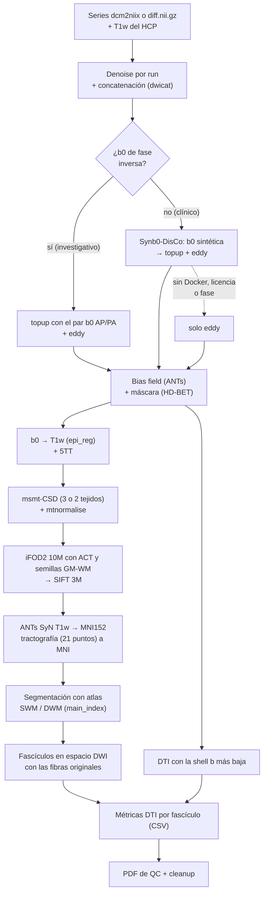

# Pipeline DWI: preprocesamiento, tractografía y segmentación de fascículos (SWM/DWM)

Pipeline creado por Sebastián Navarrete (sebastian.navarrete@biomedica.udec.cl) en el Laboratorio de Visualización de la Universidad de Concepción. Toma imágenes de difusión (la salida de `dcm2niix` o un `diff.nii.gz`) y un T1w procesado con el pipeline estructural del HCP, y entrega por sujeto:

- la DWI preprocesada (denoise, corrección de distorsión por susceptibilidad, eddy, bias field) y su máscara;
- mapas DTI (FA, MD, AD, RD);
- una tractografía probabilística de 3 millones de fibras filtrada con SIFT, en espacio DWI y en MNI152;
- los fascículos de fibras largas (DWM, 36) y cortas (SWM, 209) segmentados con atlas;
- las métricas DTI de cada fascículo en un CSV;
- un PDF de control de calidad para revisar rápidamente cada sujeto.

Se basa en MRtrix3, FSL, ANTs y, para datos clínicos, Synb0-DisCo.

## Contenido

- [Dos tipos de adquisición, un solo pipeline](#dos-tipos-de-adquisición-un-solo-pipeline)
- [Requisitos](#requisitos)
- [Instalación](#instalación)
- [Estructura de datos](#estructura-de-datos)
- [Modo de uso](#modo-de-uso)
- [Qué hace y cómo lo hace](#qué-hace-y-cómo-lo-hace)
- [Cambios respecto a la versión 1](#cambios-respecto-a-la-versión-1)
- [QC en PDF](#qc-en-pdf-qc_dwipy)
- [Cleanup](#cleanup--cleanup)
- [Archivos de salida](#archivos-de-salida-proc_dwi_v2)
- [Referencias](#referencias)

## Dos tipos de adquisición, un solo pipeline

El procesamiento es el mismo para datos investigativos y clínicos. Lo único que cambia es cómo se corrige la distorsión por susceptibilidad, que depende de si la adquisición tiene una b0 con la dirección de fase invertida:

| Modo | Adquisición | Corrección de distorsión (`-sdc`) |
|---|---|---|
| **Investigativo** | Multishell, uno o más runs AP + una serie b0 en PA | `topup`: topup con el par de b0 AP/PA, luego eddy |
| **Clínico** | Single-shell o multishell, solo AP o solo PA | `synb0`: Synb0-DisCo genera, a partir del T1w, una b0 sin distorsión que topup usa como b0 "inversa"; luego eddy |
| Sin corrección posible | Sin b0 inversa ni Synb0 disponible | `none`: solo eddy (corrientes inducidas y movimiento) |

Con `-sdc auto` (por defecto) el modo se elige solo, por sujeto: `topup` si hay una b0 de fase inversa; si no, `synb0` si hay Docker/Apptainer, licencia de FreeSurfer y dirección de fase conocida; y si no, `none`. El modo usado queda en el log, en `metodos.json` y en el PDF de QC.

> [!NOTE]
> **Recursos compartidos y versión 1.** Los atlas (`AtlasRo/`, `atlas_faisceaux/` y sus versiones `_tck`), `main_index`, `tck2bundles.npy`, las plantillas MNI y `read_write_bundle.py` no se copian en esta carpeta: se leen de [`../Pipeline_ProcesamientoDiff_TractySegmentacion/`](../Pipeline_ProcesamientoDiff_TractySegmentacion/), donde siguen la versión 1 (`Procesamiento_Mrtrix3.py`) y los demás scripts que los usan. Para usar otra ubicación se define la variable de entorno `NEUROCISC_RECURSOS`. La versión 1 no cambia, así que los datos ya procesados con ella se pueden reproducir.

## Requisitos

| Software | Uso | Probado con |
|---|---|---|
| MRtrix3 | Casi todo el procesamiento | 3.0.8 |
| FSL ≥ 6.0.6 | topup, eddy, epi_reg, flirt, `5ttgen fsl`, eddy_quad | 6.0.7 |
| ANTs | `dwibiascorrect ants`, `antsRegistrationSyN.sh` y `antsApplyTransforms` (en el `PATH`) | 2.6.5 |
| Python 3 | `nibabel`, `numpy`, `scipy`, `pandas`, `dipy`, `joblib`, `matplotlib` | 3.13 (NumPy 2) |
| HD-BET (opcional) | Máscara DWI (`pip install hd-bet`); si no está, se usa `dwi2mask` | 2.0.1 |
| GPU NVIDIA (opcional) | `eddy_cuda` (eddy en minutos en vez de horas) y HD-BET | RTX 3060 |
| Docker o Apptainer/Singularity (modo clínico) | Synb0-DisCo, imagen `leonyichencai/synb0-disco:v3.1` (~12 GB). No requiere GPU | Docker |
| Licencia de FreeSurfer (modo clínico) | La exige Synb0. Se busca en `-fs_license`, `FS_LICENSE`, `$FREESURFER_HOME/license.txt` o `~/license.txt` | — |

Docker debe poder usarse sin `sudo`. En clusters sin Docker: `apptainer pull synb0.sif docker://leonyichencai/synb0-disco:v3.1` y luego `-container apptainer -synb0_sif synb0.sif`.

## Instalación

El pipeline usa los atlas, `main_index` y las plantillas del repositorio [Lab_viz_UDEC](https://github.com/SebNav/Lab_viz_UDEC). Basta con dejar esta carpeta junto a `Pipeline_ProcesamientoDiff_TractySegmentacion/`:

```
git clone https://github.com/SebNav/Lab_viz_UDEC.git
cd Lab_viz_UDEC/Algoritmos_y_Archivos
git clone https://github.com/SebNav/Pipeline_DWI.git
python3 Pipeline_DWI/Procesamiento_DWI.py -h
```

Si los recursos están en otra ubicación, se indica con `export NEUROCISC_RECURSOS=/ruta/a/Pipeline_ProcesamientoDiff_TractySegmentacion`.

## Estructura de datos

Una carpeta con un subdirectorio por sujeto. Cada sujeto necesita el T1w  y las imágenes de difusión en uno de dos formatos; no hace falta renombrar nada.

**1. Salida de `dcm2niix`** (en cualquier subcarpeta del sujeto). Se usan las series `ORIGINAL` de difusión; los mapas que genera el escáner (ADC, TRACEW, FA, ColFA) se descartan por su `ImageType`.

- Series con `.bval/.bvec` y b > 0 → runs DWI. Si hay varios, se concatenan en orden de `SeriesNumber` y deben tener la misma fase, el mismo readout y la misma geometría.
- Series de solo b0 con la fase opuesta a la DWI → b0 de fase inversa para topup.
- La dirección de fase y el readout se leen de los `.json`.

```
Carpeta_sujetos
   |--> Sujeto01                                    (investigativo)
   |	|--> XXXX_AP_ep2d_diff_mddw_1000_30_11.nii.gz / .json / .bval / .bvec
   |	|--> XXXX_AP_ep2d_diff_mddw_2000_64_17.nii.gz / .json / .bval / .bvec
   |	|--> XXXX_PA_ep2d_diff_mddw_20_p2_23.nii.gz / .json
   |	|--> (ADC, TRACEW, FA, ColFA, fMRI, field maps... se ignoran)
   |	L--> T1w/
   |	      |--> T1w_acpc_dc_restore_brain.nii.gz     (obligatorio)
   |	      L--> T1w_acpc_dc_restore.nii.gz           (opcional: epi_reg y Synb0 con cráneo)
```

**2. Formato de la versión 1** (`diff.nii.gz`, típico de datos clínicos). La dirección de fase se toma de `diff.json` (el `.json` de `dcm2niix`, si se conservó), de un `acq.json` en la carpeta del sujeto o de los argumentos `-pe_dir`/`-readout`.

```
   |--> Sujeto02                                    (clínico)
   |	|--> diff.nii.gz / diff.bval / diff.bvec
   |	|--> diff.json o acq.json                   (opcional)
   |	|--> T1w_acpc_dc_restore_brain.nii.gz       (obligatorio)
   |	L--> T1w_acpc_dc_restore.nii.gz             (opcional)
```

`acq.json` mínimo:

```json
{"PhaseEncodingDirection": "j-", "TotalReadoutTime": 0.05}
```

Para Synb0, el dato imprescindible es el **eje** de la fase (`i`, `j` o `k`, en los ejes del NIfTI). Sin él, el sujeto se procesa sin corrección de susceptibilidad y se avisa. La polaridad y el readout solo invierten o escalan el campo estimado, y topup y eddy usan los mismos valores; si falta el readout, se usa 0,05 s.

Los resultados de cada sujeto se guardan en `SujetoXX/proc_dwi_v2/`. Los datos originales no se modifican.

## Modo de uso

Los scripts se pueden ejecutar desde cualquier carpeta.

**1. Validar los datos** sin procesar (recomendado siempre antes de lanzar el pipeline):

```
python3 Procesamiento_DWI.py -folder Carpeta_sujetos -check
```

Para cada sujeto se listan las series detectadas, los b-values, la dirección de fase y su fuente, el modo de corrección que se usará y los avisos, o los motivos por los que se omitirá (falta el T1w, la b0 inversa no tiene la fase opuesta o su geometría no coincide, etc.):

```
[OK] Sujeto01  -> topup con b0 de fase inversa (investigativo)
     DWI: XXXX_AP_ep2d_diff_mddw_1000_30_11  (33 vol, b=[0, 1000])
     DWI: XXXX_AP_ep2d_diff_mddw_2000_64_17  (67 vol, b=[0, 2500])
     b0 inversa: XXXX_PA_ep2d_diff_mddw_20_p2_23  (PE j)
     PE: j-  readout: 0.0457208 s  (fuente: XXXX_AP_ep2d_diff_mddw_1000_30_11.json)
```

**2. Procesar.** Ejemplos:

```
# Investigativo completo: DTI, segmentación SWM y DWM, y borrado de intermedios
python3 Procesamiento_DWI.py -folder Carpeta_sujetos -dti -segmentacion SWM DWM -cleanup

# Clínico con diff.nii.gz sin .json: hay que indicar la dirección de fase
python3 Procesamiento_DWI.py -folder Carpeta_clinicos -pe_dir j- -dti -segmentacion SWM DWM

# Solo algunos sujetos
python3 Procesamiento_DWI.py -folder Carpeta_sujetos -sujetos Sujeto01 Sujeto07 -dti -segmentacion DWM

# Clínico en un cluster con Apptainer
python3 Procesamiento_DWI.py -folder Carpeta_clinicos -pe_dir j- -container apptainer -synb0_sif synb0.sif -dti -segmentacion SWM DWM

# Forzar un modo (p. ej. no usar Synb0 aunque esté disponible)
python3 Procesamiento_DWI.py -folder Carpeta_clinicos -sdc none -dti
```

| Argumento | Descripción |
|---|---|
| `-folder` | Carpeta con los sujetos (obligatorio). |
| `-sujetos S1 S2 ...` | Procesa solo los sujetos indicados (nombres de carpeta). |
| `-check` | Solo valida los datos, no procesa. |
| `-dti` | Calcula `dti_FA/MD/AD/RD.nii.gz` con la shell b más baja, comparable entre datos clínicos e investigativos. Junto con `-segmentacion`, calcula también las métricas por fascículo. |
| `-segmentacion SWM DWM` | Segmenta fascículos cortos (SWM), largos (DWM) o ambos. |
| `-sdc auto\|topup\|synb0\|none` | Corrección de distorsión por susceptibilidad (ver [arriba](#dos-tipos-de-adquisición-un-solo-pipeline)). Por defecto, `auto`. |
| `-pe_dir`, `-readout` | Dirección de fase (`i`, `i-`, `j`, `j-`, `k`, `k-`) y readout en segundos, si no están en los `.json` ni en `acq.json`. |
| `-container auto\|docker\|apptainer\|singularity` | Runtime de contenedores para Synb0 (por defecto, el primero disponible). |
| `-synb0_image`, `-synb0_sif` | Imagen de Synb0 (por defecto `leonyichencai/synb0-disco:v3.1`) o archivo `.sif` local para Apptainer. |
| `-fs_license` | Licencia de FreeSurfer para Synb0. |
| `-mask auto\|hdbet\|dwi2mask` | Método de la máscara DWI. `auto` usa HD-BET si está instalado y, si no, `dwi2mask`. |
| `-degibbs` | Aplica `mrdegibbs`. Desactivado por defecto: no se recomienda con Partial Fourier. |
| `-no_qc` | No genera el PDF de QC. |
| `-cleanup` | Al terminar cada sujeto borra los archivos intermedios (ver [Cleanup](#cleanup--cleanup)). |
| `-nthreads N` | Número de hilos (por defecto, todos). |

**Reanudar y rehacer.** Si un sujeto falla, se registra el error en `proc_dwi_v2/pipeline_v2.log` y el pipeline sigue con el siguiente. Para reanudarlo basta con volver a ejecutar el mismo comando: cada paso se omite si su salida ya existe. Para rehacer un paso, hay que borrar su salida en `proc_dwi_v2/` y las de los pasos posteriores. El modo de corrección de un sujeto ya preprocesado no se puede cambiar sin borrar `proc_dwi_v2/`.

**Tiempo por sujeto** (24 núcleos, RTX 3060), en una adquisición investigativa de 100 volúmenes y 2 shells: ~1 h 35 min. El preprocesamiento hasta la máscara toma ~30 min (topup + eddy en GPU, ~18 min); la tractografía, ~55 min (`tckgen` 10M, ~50 min, y SIFT); el registro a MNI, la segmentación, las métricas y el QC, ~10 min. Synb0 agrega ~13 min.

## Qué hace y cómo lo hace



| Etapa | Qué se hace | Cómo |
|---|---|---|
| Entrada | Copia los runs y registra cómo se va a procesar el sujeto | `run<N>.nii.gz` + bvec/bval; `pe.json` con la fase y el readout; `metodos.json` con las entradas, el modo y las versiones del software |
| Denoise | Reduce el ruido térmico de cada run y los une | `dwidenoise` por run (y `mrdegibbs` con `-degibbs`); `dwicat` reescala la intensidad entre runs antes de concatenarlos |
| Distorsión + eddy | Corrige la distorsión por susceptibilidad, las corrientes inducidas y el movimiento | `topup`: `dwifslpreproc -rpe_pair -se_epi` con el par b0. `synb0`: Synb0-DisCo → `topup` → `eddy --topup`. `none`: `dwifslpreproc -rpe_none`. eddy siempre con `--slm=linear --repol --data_is_shelled` (reemplaza cortes con pérdida de señal) |
| Bias y máscara | Corrige la inhomogeneidad de intensidad y delimita el cerebro | `dwibiascorrect ants`; HD-BET sobre el b0 medio (o `dwi2mask`) |
| DTI | Mapas FA, MD, AD y RD (opcional, `-dti`) | `dwi2tensor` + `tensor2metric` con b = 0 y la shell b más baja (el tensor no modela bien b altos) |
| T1w ↔ DWI | Lleva el T1w al espacio de difusión y segmenta tejidos | `epi_reg` (BBR) si existe el T1w con cráneo, si no `flirt` 6 dof; transformación aplicada al T1w; `5ttgen fsl` |
| CSD | Estima la orientación de las fibras en cada vóxel | `dwi2response dhollander` + `dwi2fod msmt_csd` + `mtnormalise`. Con ≥ 2 shells b > 0 se estiman 3 tejidos (WM, GM, CSF); con una sola shell, 2 (WM + CSF), porque sin una segunda shell no se distinguen GM y CSF |
| Tractografía | Reconstruye 3M fibras anatómicamente plausibles | `tckgen` iFOD2, 10M fibras de 25-250 mm, con ACT (`-act -backtrack -crop_at_gmwmi`) y semillas en la interfaz sustancia gris-blanca (`5tt2gmwmi` + `-seed_gmwmi`); `tcksift` a 3M. Se guarda la tractografía original (`tractography_prob_sift_3M.tck`) |
| MNI | Lleva la tractografía al espacio de los atlas | `antsRegistrationSyN.sh` del T1w (espacio DWI) a MNI152 1 mm; la tractografía se remuestrea a 21 puntos por fibra (`tckresample`) y se transforma con `tcktransform`; se verifica que todas las fibras conserven los 21 puntos |
| Segmentación | Asigna las fibras a los fascículos de los atlas | `main_index` compara cada fibra en MNI con los atlas SWM (AtlasRo) y DWM (atlas_faisceaux). Los fascículos en espacio DWI se extraen de la tractografía original con los mismos índices (`tckresample` conserva el orden de las fibras) |
| Métricas | Resume FA, AD, RD y MD por fascículo | `metricas/bundle_metrics_<DWM\|SWM>.csv` (con `-dti` y `-segmentacion`, ver nota) |
| QC | Reporte por sujeto | `QC/QC_<sujeto>.pdf` (ver [QC en PDF](#qc-en-pdf-qc_dwipy)) y el reporte de eddy_quad |

> [!NOTE]
> **Synb0-DisCo.** Corre en un contenedor con la imagen fijada por versión; su digest queda en `metodos.json`. Recibe el b0 medio tras el denoise y el T1w con cráneo si existe (si no, el T1w sin cráneo con `--stripped`). Los vectores de fase de topup y de eddy se exportan con MRtrix desde `pe.json` con los mismos strides, de modo que la b0 y la entrada de eddy quedan en los mismos ejes. eddy recibe solo la línea de la b0 real, porque FSL ≥ 6.0.6 rechaza un readout 0. Synb0 corrige la **geometría**: no recupera señal perdida (dropout) ni zonas fuera del FOV.

> [!NOTE]
> **Registro a MNI con ANTs SyN.** Para `tcktransform` se necesita, en cada vóxel del sujeto, su coordenada MNI: se muestrea una identidad de MNI con la transformación inversa (`warpinit` + `antsApplyTransforms` + `warpcorrect`). La grilla MNI se amplía 40 mm: si un punto queda fuera, `tcktransform` lo descarta, y como `main_index` lee las fibras con largo fijo, una fibra con menos de 21 puntos corrompe la segmentación sin dar error. Por eso el pipeline verifica que todas las fibras en MNI tengan 21 puntos y se detiene si no. Frente a fnirt (versión 1), la correlación T1w-MNI subió de 0,834 a 0,915 y de 0,831 a 0,902 en los dos sujetos de prueba.

> [!NOTE]
> **Métricas por fascículo.** `metricas/bundle_metrics_DWM.csv` y `metricas/bundle_metrics_SWM.csv` tienen una fila por fascículo del atlas y métrica (FA, AD, RD, MD), con las columnas `bundle,metrics,space,n_streamlines,vol_mm3,mean,std,median,IQR`. Todo se calcula en el espacio DWI nativo (`space` = `DWI`) sobre las fibras originales de `results_folder_DWI` (no las de 21 puntos). `vol_mm3` es el volumen de los vóxeles que atraviesan las fibras, dentro de la máscara DWI. Para `mean/std/median/IQR`, cada mapa se promedia a lo largo de cada fibra (interpolación trilineal, puntos cada medio vóxel) y luego se resumen esos promedios entre las fibras del fascículo. Los fascículos sin fibras quedan con `n_streamlines` = 0 y estadísticas vacías. Si un fascículo no está completo dentro del FOV (página 6 del QC), sus métricas corresponden solo al tramo adquirido.

> [!NOTE]
> **Formato `.nii.gz`.** No se guardan archivos `.mif`. Como `dwidenoise`, `mrdegibbs` y `dwibiascorrect` no modifican los gradientes, hay solo dos tablas: `dwi_den.bvec/.bval` (originales, entrada de la corrección de distorsión) y `dwi_preproc.bvec/.bval` (rotadas por eddy), que se pasan con `-fslgrad` a todos los pasos posteriores. Como el NIfTI no guarda la dirección de fase, esta se pasa desde `pe.json`. `dwicat` no acepta `-fslgrad`, así que con 2 o más runs usa `.mif` temporales que se borran en el mismo paso.

> [!NOTE]
> **Máscara DWI con HD-BET.** `dwi2mask` tiende a incluir tejido de la base del cráneo y de las órbitas. HD-BET se aplica al b0 medio de los datos preprocesados (en GPU si hay `nvidia-smi`, ~40 s; si no, en CPU sin TTA). En un sujeto de prueba, el Dice contra el cerebro del T1w subió de 0,887 (`dwi2mask`) a 0,979 (HD-BET). Para HD-BET se fuerza `MKL_THREADING_LAYER=GNU`, porque numpy deja la capa INTEL en el entorno y torch falla con libgomp.

> [!WARNING]
> `main_index` (segmentación) corrompe memoria si recibe rutas largas, así que se ejecuta desde `proc_dwi_v2/` con enlaces temporales al atlas y rutas relativas cortas. Además, puede terminar con `free(): invalid next size` **después** de escribir sus resultados; en ese caso el resultado se acepta solo si generó un archivo de índices por cada fascículo del atlas, y se registra un `AVISO` en `pipeline_v2.log`.

## Cambios respecto a la versión 1

| Etapa | Versión 1 (`Procesamiento_Mrtrix3.py`) | Esta versión (`Procesamiento_DWI.py`) |
|---|---|---|
| Datos admitidos | Un `diff.nii.gz` por sujeto | Investigativos (multishell, varios runs, b0 AP/PA) y clínicos (single-shell, solo AP o solo PA) |
| Entrada | `diff.nii.gz/.bval/.bvec` renombrados a mano | Busca solo las series de `dcm2niix` en cualquier subcarpeta, o usa `diff.nii.gz` |
| Dirección de fase | Argumento `-phase_encoding`, `j-` por defecto sin aviso | Leída de los `.json` (o `acq.json`/`-pe_dir`); se avisa si se asume |
| Validación | Solo que existan los archivos | `-check`: fase opuesta, readout y geometría de la b0 inversa y de los runs; modo de corrección por sujeto |
| Denoise | Sobre una sola serie | `dwidenoise` por run y concatenación con `dwicat` |
| Gibbs | `mrdegibbs` siempre | Opcional (`-degibbs`) |
| Distorsión por susceptibilidad | No se corregía (`-rpe_none`) | topup con el par AP/PA, o Synb0-DisCo si no hay b0 inversa |
| eddy | Sin opciones | `--slm=linear --repol --data_is_shelled`; reporte de eddy_quad |
| Bias field | No se aplicaba (aunque el archivo se llamaba `dwi_preproc_unbiased`) | `dwibiascorrect ants` |
| Máscara DWI | `dwi2mask` | HD-BET (o `dwi2mask`) |
| Registro b0 → T1w | `flirt` 6 dof | `epi_reg` (BBR) si existe el T1w con cráneo |
| CSD | `dwi2fod` sobre `dwi.mif` **sin preprocesar** (error de v1), siempre 3 tejidos | `msmt_csd` sobre los datos preprocesados + `mtnormalise`; 2 tejidos si hay una sola shell |
| DTI | — | Opcional (`-dti`): FA, MD, AD y RD con la shell b más baja |
| Tractografía | iFOD2 10M sobre los FOD sin normalizar, semillas en toda la máscara DWI; solo se guardaba la versión de 21 puntos | FOD normalizados, semillas en la interfaz GM-WM; se conserva la tractografía SIFT original |
| Registro T1w → MNI152 | `flirt` + `fnirt` con parámetros por defecto y plantilla de 3 mm | ANTs SyN contra MNI152 1 mm; grilla ampliada y verificación de los 21 puntos |
| Fascículos en espacio DWI | Fibras de 21 puntos | Fibras originales (mismos índices) |
| Métricas por fascículo | Script aparte (`Extracion_metricas_difusion/`), vecino más cercano | Integradas: `metricas/bundle_metrics_<DWM\|SWM>.csv` |
| QC | — | PDF por sujeto con 9 páginas y cobertura del FOV por fascículo |
| Formato | `.mif` | Todo en `.nii.gz`; gradientes en `bvec/bval` |
| Errores | Los comandos fallidos se ignoraban (`os.system`) | El sujeto se detiene ante un error y se sigue con el siguiente; todo queda en `pipeline_v2.log` |
| Reanudación | Solo si existía el archivo final; si no, se rehacía todo | Cada paso se omite si su salida ya existe |
| Ejecución | Desde la carpeta del script, con los archivos auxiliares en ella | Desde cualquier carpeta; `-nthreads`; `-cleanup` |
| Resultados | En la carpeta del sujeto, mezclados con los datos | En `SujetoXX/proc_dwi_v2/` |

## QC en PDF (`qc_dwi.py`)

Al terminar cada sujeto se genera `proc_dwi_v2/QC/QC_<sujeto>.pdf` (se desactiva con `-no_qc`) y se copia ahí el reporte de eddy_quad como `QC/QC_eddy_<sujeto>.pdf`. El PDF está pensado para detectar rápido los problemas de un sujeto antes de pasar a los análisis, y todo el QC está en él. También se puede generar o regenerar por separado:

```
python3 qc_dwi.py Carpeta_sujetos            # todos los sujetos con pipeline completo
python3 qc_dwi.py Carpeta_sujetos/Sujeto01   # un solo sujeto
python3 qc_dwi.py Carpeta_sujetos -force     # regenera también las imágenes intermedias (qc_tmp/)
```

| Página | Qué revisar |
|---|---|
| 1. Resumen | Series usadas y corrección de distorsión (en rojo si no se corrigió), movimiento de eddy, mapa de cortes outlier y lista de volumen/corte reemplazados, métricas con referencia orientativa (OK / REVISAR), fascículos segmentados y fascículos dentro del FOV (x/y) |
| 2. Corrección de distorsión | b0 sin corregir, b0 de fase inversa (topup) o b0 sintética (Synb0) y b0 corregido, con el borde de sustancia blanca del T1w: tras la corrección, el b0 debe ajustarse al contorno |
| 3. Registro T1w → espacio DWI | FA con el borde de sustancia blanca del T1w, y T1w con la máscara DWI y FA = 0,3 |
| 4. 5TT | Tejido dominante de cada vóxel sobre el T1w en espacio DWI |
| 5. Registro T1w → MNI152 | T1w deformado con los contornos de la plantilla y al revés, con una guía de lectura |
| 6. Cobertura del FOV | Plantilla MNI con la máscara DWI del sujeto (en rojo, el cerebro que quedó fuera de la adquisición) y % de fibras de cada fascículo del atlas que quedan enteras dentro de ella: barras por fascículo DWM, SWM ordenados y lista de parciales e incompletos |
| 7. Tractografía | Densidad de fibras (TDI) en espacio DWI y en MNI: debe quedar dentro del cerebro y seguir la sustancia blanca |
| 8-9. Fascículos DWM / SWM | Proyección de cada fascículo sobre el T1w, x/y segmentados y lista de los no segmentados |

Métricas del resumen:

| Métrica | Referencia | Interpretación |
|---|---|---|
| Dice máscara DWI vs cerebro T1w | ≥ 0,85 | Valores bajos sugieren un mal registro DWI → T1w o una mala máscara |
| Rotación DWI → T1w | ≤ 15° | Rotaciones grandes sugieren que el registro falló |
| Correlación T1w deformado vs MNI | ≥ 0,80 | Calidad del registro no lineal a MNI |
| Puntos de fibras en máscara DWI / en cerebro MNI | ≥ 0,95 | Verifica que la tractografía (y su transformación a MNI) quede dentro del cerebro |
| Movimiento relativo medio | ≤ 0,5 mm | Movimiento entre volúmenes estimado por eddy |
| Fascículos DWM / SWM segmentados | todos | Un fascículo no segmentado que sí está dentro del FOV apunta a la tractografía o al registro |
| Fascículos DWM / SWM dentro del FOV | todos | Fascículos con < 85 % de sus fibras de atlas dentro de la máscara DWI: la adquisición los corta |

La **cobertura del FOV** no depende de la tractografía del sujeto: la máscara DWI se lleva a MNI y se cuentan las fibras de los atlas (`atlas_faisceaux_tck/`, `AtlasRo_tck/`) que quedan enteras dentro de ella. Así se distingue un fascículo que la adquisición no alcanzó a cubrir (p. ej. vértex cortado) de uno que falló en la tractografía o la segmentación. Un fascículo es completo con ≥ 85 % de sus fibras dentro, parcial con ≥ 60 % e incompleto por debajo. En un sujeto investigativo (FOV completo) todos los fascículos superan el 92 %. En un sujeto clínico con el vértex cortado, 18 de 36 fascículos DWM quedaron bajo el 85 % (tálamo-motor, corticoespinal y cuerpo calloso, entre 14 y 56 %).

Las referencias no son un estándar publicado: son valores orientativos propuestos para este pipeline y no deben usarse como umbral estricto ni como criterio de exclusión. Ante un `REVISAR` hay que mirar las páginas correspondientes, y conviene ajustar las referencias según la distribución de la cohorte.

## Cleanup (`-cleanup`)

Con `-cleanup`, al terminar cada sujeto (y solo si existe el PDF de QC) se borran los archivos intermedios. En un sujeto investigativo, la carpeta baja de ~5,2 GB a ~3,0 GB.

| Se borra | Motivo |
|---|---|
| `run<N>.nii.gz/.bvec/.bval`, `run*_den*.nii.gz`, `run*_noise.nii.gz` | Copias de la entrada, incluidas en `dwi_den`, y mapas de ruido |
| `b0_PA`, `b0_PA_unr`, `b0_AP`, `b0_PA_sel`, `b0_pair`, `bzero` | Volúmenes b0 intermedios (entrada de topup y b0 medio para epi_reg) |
| `synb0/`, `b0_pre`, `b0_topup*`, `eddy_in`, `eddy_out*`, `eddy_mask`, `eddy_acqp.txt`, `eddy_index.txt`, `bvecs`, `bvals` | Intermedios de Synb0 y de eddy (se conserva `b0_synb0.nii.gz` para el QC) |
| `dwi_den.nii.gz`, `dwi_preproc.nii.gz` | Entrada de eddy y DWI antes de bias (se conservan sus `.bvec/.bval`) |
| `tractography_prob_sift_3M_21p.tck` | Tractografía de 21 puntos en espacio DWI: solo sirve para llevarla a MNI y se regenera desde la original si hace falta |
| `tractography_prob_sift_3M_21p_MNI.bundles/.bundlesdata` | Tractograma completo en formato `.bundles` (se conserva el `.tck`) |
| `gmwmi_seed.nii.gz` | Semillas de la interfaz GM-WM para `tckgen` |
| `wmfod`, `gm`, `csf` sin normalizar | Reemplazados por `*_norm` |
| `tensor`, `RF_voxels`, `b0_mean_hdbet`, `b0_hdbet_bet` | Ya extraídos en `dti_*` / auxiliares de la máscara |
| `diff2struct_epireg*`, `ants_T12MNI_Warped/InverseWarped` | Auxiliares de epi_reg e imágenes deformadas por ANTs (el QC las recalcula) |
| `eddy_qc/` | Métricas de texto de eddy; su reporte (eddy_quad) queda en `QC/QC_eddy_<sujeto>.pdf` |
| `qc_tmp/` | Imágenes intermedias del QC; se conserva la carpeta `QC/` |

De las imágenes DWI solo quedan las originales (fuera de `proc_dwi_v2/`) y `dwi_preproc_unbiased.nii.gz` con `dwi_preproc.bvec/.bval`. De las tractografías quedan la original (`tractography_prob_sift_3M.tck`) y la de MNI (`tractography_prob_sift_3M_21p_MNI.tck`). Se conservan además máscara, DTI, registros, 5TT, FOD normalizados, warps, los fascículos de `DWM/` y `SWM/`, `metricas/`, la carpeta `QC/`, `metodos.json` y el log.

Los archivos borrados quedan listados en `.cleanup_done`. Al reanudar, el pipeline los considera existentes, así que no repite pasos. El QC se puede regenerar después del cleanup (`qc_dwi.py -force`); como `eddy_qc/` ya no existe, el PDF regenerado no incluye el gráfico de movimiento ni el mapa de outliers de la página 1 (siguen en `QC/QC_eddy_<sujeto>.pdf`).

## Archivos de salida (`proc_dwi_v2/`)

| Archivo | Contenido |
|---|---|
| `metodos.json`, `pe.json` | Entradas usadas, corrección de distorsión, fase y readout (con su fuente), shells, tejidos de la CSD y versiones de MRtrix, FSL, ANTs y Synb0 |
| `pipeline_v2.log` | Cada comando ejecutado con fecha y hora, su salida y los avisos |
| `dwi_preproc_unbiased.nii.gz` + `dwi_preproc.bvec/.bval`, `dwi_mask.nii.gz` | DWI preprocesada, sus gradientes rotados por eddy, y máscara |
| `b0_synb0.nii.gz` | b0 sintética sin distorsión de Synb0 (modo clínico) |
| `dti_FA/MD/AD/RD.nii.gz` | Mapas DTI (con `-dti`) |
| `T1w_acpc_dc_restore_brain_diff_space.nii.gz`, `5TT.nii.gz` | T1w y segmentación de 5 tejidos en espacio de difusión |
| `wmfod_norm.nii.gz` | FOD de sustancia blanca (msmt-CSD + mtnormalise) |
| `tractography_prob_sift_3M.tck` | Tractografía SIFT (3M fibras) en espacio de difusión, con todos sus puntos (paso ~1 mm) |
| `tractography_prob_sift_3M_21p_MNI.tck` | Tractografía remuestreada a 21 puntos en espacio MNI152 |
| `ants_T12MNI_0GenericAffine.mat`, `ants_T12MNI_1Warp.nii.gz`, `ants_T12MNI_1InverseWarp.nii.gz` | Registro T1w (espacio DWI) → MNI152 1 mm de ANTs SyN |
| `mrtrix_warp_MNI2dwi.nii.gz`, `mrtrix_warp_dwi2MNI.nii.gz` | Campos de deformación entre espacios (formato MRtrix) |
| `SWM/`, `DWM/` | Fascículos segmentados (con `-segmentacion`): `results_folder/` en MNI (21 puntos) y `results_folder_DWI/` en espacio DWI con las fibras originales |
| `metricas/bundle_metrics_DWM.csv`, `metricas/bundle_metrics_SWM.csv` | Métricas DTI por fascículo en espacio DWI (con `-dti` y `-segmentacion`) |
| `QC/QC_<sujeto>.pdf`, `QC/QC_eddy_<sujeto>.pdf` | Reporte de QC del pipeline y reporte de eddy_quad |

## Referencias

Si se usa este pipeline, se deben citar las herramientas en las que se basa:

- MRtrix3: Tournier et al., *NeuroImage* 2019;202:116137.
- dwidenoise: Veraart et al., *NeuroImage* 2016;142:394-406. dwicat y dwibiascorrect: MRtrix3.
- topup: Andersson et al., *NeuroImage* 2003;20:870-888. eddy: Andersson & Sotiropoulos, *NeuroImage* 2016;125:1063-1078; `--repol`: Andersson et al., *NeuroImage* 2016;141:556-572.
- Synb0-DisCo: Schilling et al., *Magn Reson Imaging* 2019;64:62-70 y *PLoS One* 2020;15(7):e0236418.
- N4 (bias field) y SyN: Tustison et al., *IEEE TMI* 2010;29:1310-1320; Avants et al., *Med Image Anal* 2008;12:26-41.
- HD-BET: Isensee et al., *Hum Brain Mapp* 2019;40:4952-4964.
- epi_reg (BBR): Greve & Fischl, *NeuroImage* 2009;48:63-72.
- msmt-CSD y dhollander: Jeurissen et al., *NeuroImage* 2014;103:411-426; Dhollander et al., ISMRM 2016. mtnormalise: Raffelt et al., ISMRM 2017.
- iFOD2: Tournier et al., ISMRM 2010. ACT y semillas GM-WM: Smith et al., *NeuroImage* 2012;62:1924-1938. SIFT: Smith et al., *NeuroImage* 2013;67:298-312.
- Atlas DWM: Guevara et al., *NeuroImage* 2012;61:1083-1099. Atlas SWM: Román et al., *Front Neuroinform* 2017;11:73.
